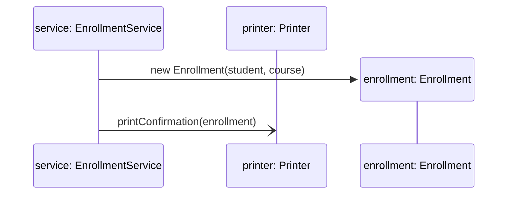
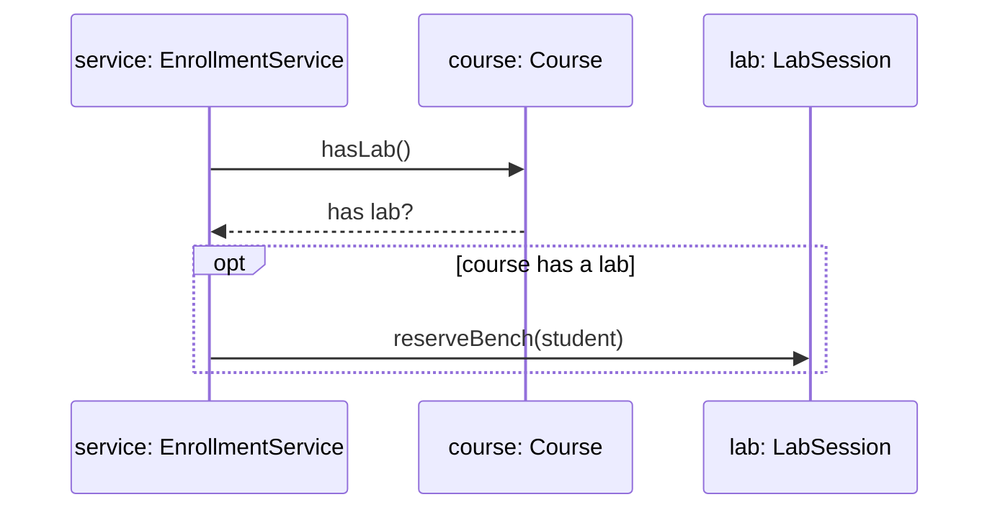
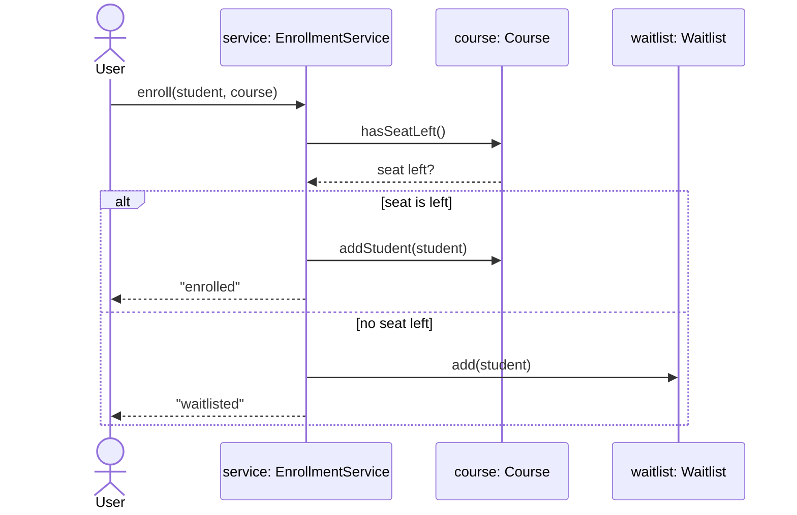
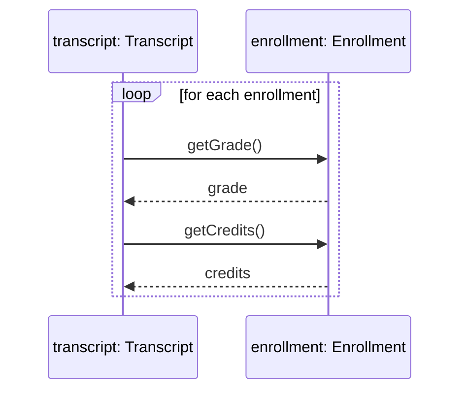
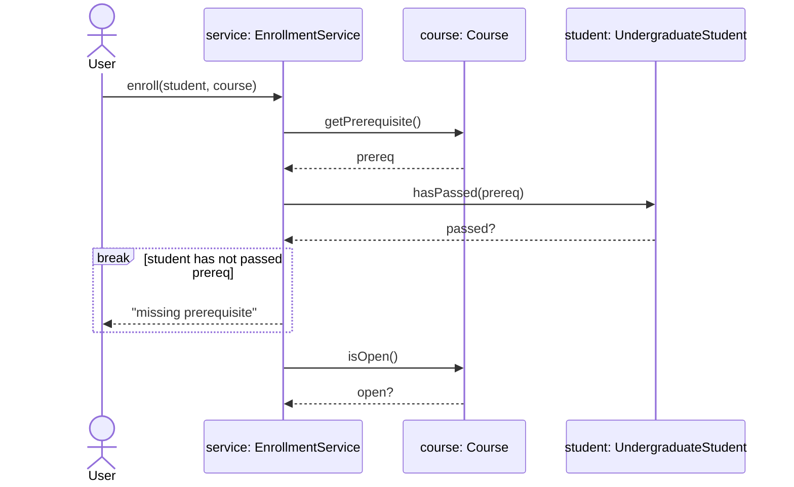
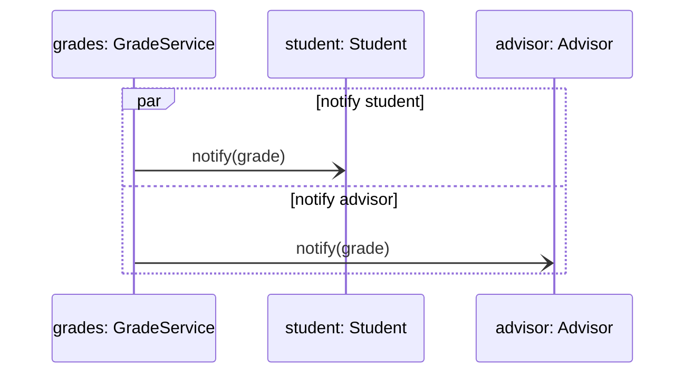
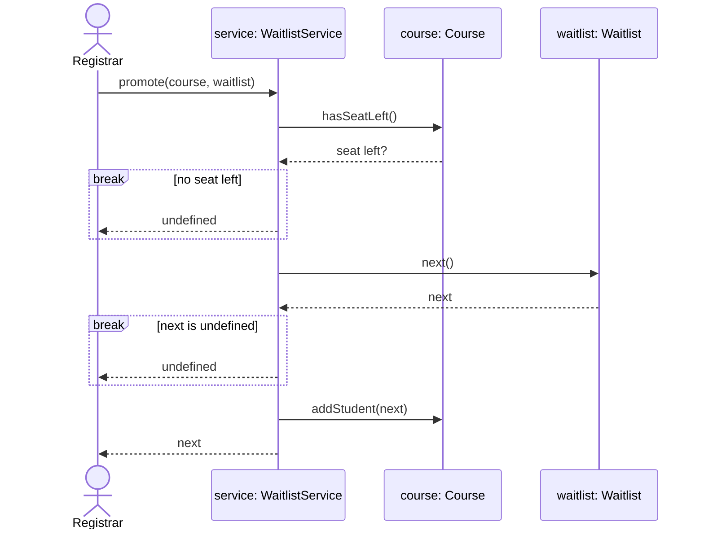
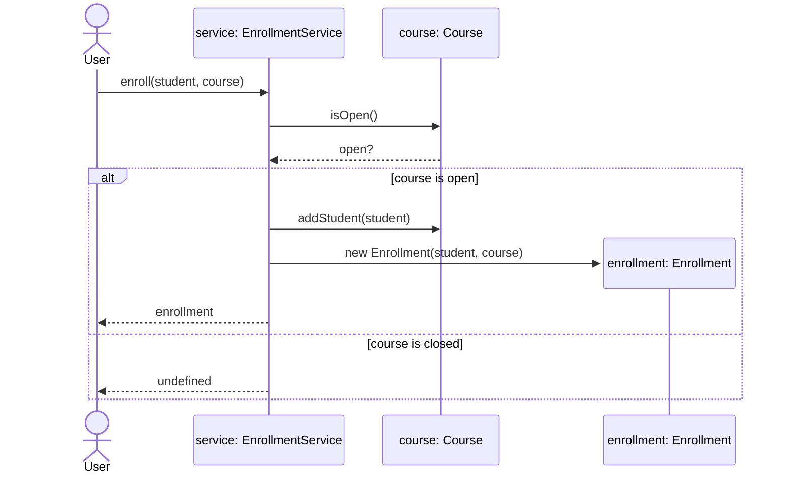

# Lab 6 — UML, Part 2: Sequence Diagrams (Course Registration)

## Exercise 1

* **(a)** Messages **3**, **5**, and **7** are returns.
* **(b)**
  * `Course` must have: `removeStudent(student)` (message **2**) and `getCredits()` (message **4**).
  * `UndergraduateStudent` must have: `removeCredits(6)` (message **6**).
* **(c)** As drawn, the service still calls `getCredits()` (4) and `removeCredits(6)` (6), so the student's credits are still reduced by 6 even though they were never enrolled. You should add an **`opt`** fragment (e.g., `opt student was enrolled`), with messages **4, 5, and 6** inside it.

---

## Exercise 2



* **(a)** Because `enrollment` is created dynamically during the interaction rather than existing at the start, so its lifeline begins at the `new Enrollment(student, course)` message.
* **(b)** In UML, an asynchronous message is drawn with a solid line and an open (stick) arrowhead.

---

## Exercise 3



---

## Exercise 4



---

## Exercise 5



---

## Exercise 6



---

## Exercise 7



---

## Exercise 8

|Sentence from the requirements|Fragment|
|---|---|
|"For each course in the student's list, …"|`loop`|
|"If the student asked for a printed timetable, also print it."|`opt`|
|"The student pays the fees either by card or by bank transfer."|`alt`|
|"If registration is closed, refuse and stop."|`break`|
|"Email the student and the advisor at the same time."|`par`|

---

## Exercise 9



---

## Exercise 10

```typescript
enrollAll(student: Student, courses: Course[]): number {
  let acceptedCount = 0;
  for (const course of courses) {
    if (course.isOpen()) {
      const credits = course.getCredits();
      if (student.addCredits(credits)) {
        acceptedCount++;
      }
    }
  }
  return acceptedCount;
}
```

---

## Exercise 11

1. Mistakes table:

|\#|Line of the diagram|What is wrong|Correction|
|---|---|---|---|
|1|`S->>E: new Enrollment(student, course)`|Creates `enrollment` before checking if the course is open.|Move `create participant E as enrollment: Enrollment` and `S->>E: new Enrollment(student, course)` inside the `course is open` branch.|
|2|`C->>S: true`|Uses a solid call arrow (`->>`) instead of a dashed return arrow (`-->>`), and gives a single fixed answer `true`.|Change to `C-->>S: open?`.|
|3|`S->>C: seats = seats - 1`|Uses an internal attribute assignment instead of a method call on `Course`.|Change to `S->>C: addStudent(student)`.|

2. Corrected diagram:


